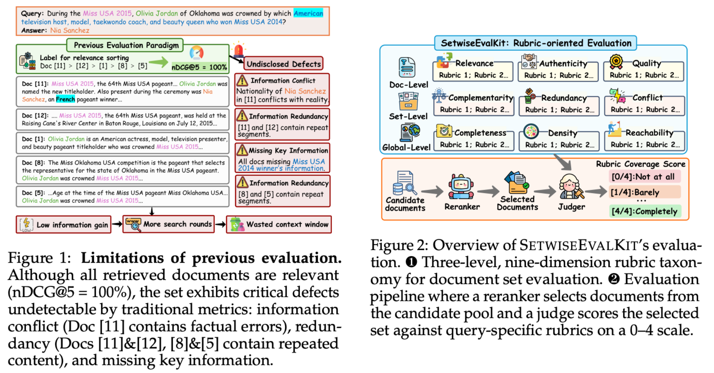
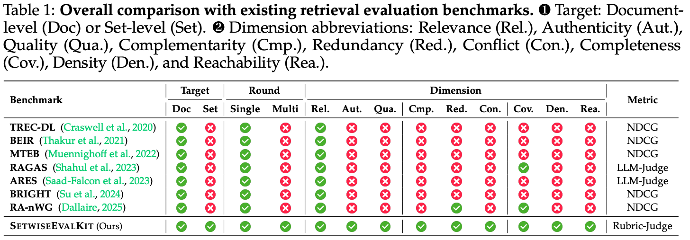
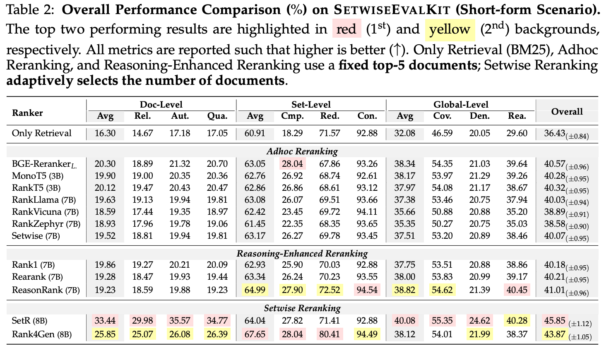
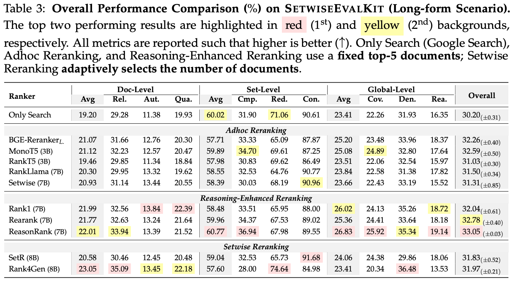
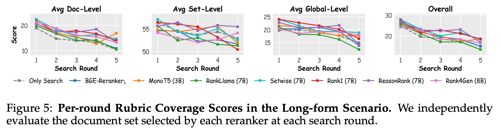
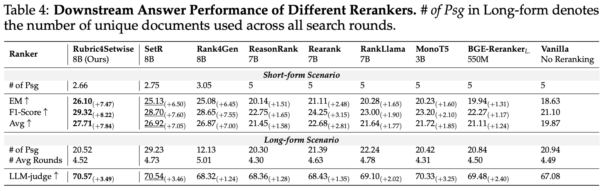

<h1 align="center"> <a href="https://arxiv.org/------">Beyond Relevance-Centric Retrieval: Rubric-Oriented Document Set Selection and Ranking</a></h1>
<h5 align="center">

[]() [](https://huggingface.co/datasets/kailinjiang/SetwiseEvalKit)  [](https://github.com/Rubric4Setwise/Rubric4Setwise)  [](https://rubric4setwise.github.io/) 

</h5>


## Table of Contents


- [Table of Contents](#table-of-contents)
- [💡 Motivation](#motivation)
- [📊 Main Results](#main-results)
- [🛠️ Requirements and Installation](#️requirements-and-installation)
- [🤖 Evaluation](#evaluation)
- [🗂️ Data Formats](#️data-formats)
- [✍️ Prompts](#️prompts)
- [🤝 Acknowledgments](#-acknowledgments)
- [📝 Citation](#-citation)


## 💡 Motivation

<p align="center">
  
</p>

<p align="center">
  
</p>

## 📊 Main Results

<p align="center">
  
</p>

<p align="center">
  
</p>

<p align="center">
  
</p>

<p align="center">
  
</p>


## 🛠️Requirements and Installation

```text
conda env create -f rubric4setwise.yml
If there are any issues, you can refer to https://github.com/DataScienceUIBK/rankify
```
or 

```text
conda create -n rubric4setwise python=3.10 -y
cd env
pip install -r rubric4setwise.txt
```


## 🤖 Evaluation

Everything is driven by `run.sh`, which runs three phases in order:

| Phase | What it does | Output |
|---|---|---|
| 1. Ranking | each reranker selects / reorders documents | `<reranker>/ranker_cache.jsonl` |
| 2. Generation | each generator answers from the selected documents | `<reranker>/<generator>/output.jsonl` |
| 3. Summarize | collects all rerankers into one file | `all_rankers_summary.jsonl` |

**Both GPU phases are data-parallel, and jobs run strictly one at a time.**
For a job (one reranker, or one reranker × generator pair), the dataset is cut
into `NUM_GPUS` shards; every GPU loads its own full copy of the model and
processes one shard; the shards are then merged and scored on the complete set.
Only when a job is finished does the next one start, so each job always has all
GPUs to itself.

```
        job i (e.g. reranker = setr)                     job i+1
  ┌───────────────────────────────────────┐        ┌──────────────
  │ GPU0  shard 0 ─┐                      │        │ GPU0 shard 0
  │ GPU1  shard 1 ─┤                      │        │ GPU1 shard 1
  │  ...          ─┼─► merge ─► score ────┼───►    │  ...
  │ GPU7  shard 7 ─┘                      │        │ GPU7 shard 7
  └───────────────────────────────────────┘        └──────────────
```

Configure the top of `run.sh` (`NUM_GPUS`, `GPU_IDS`, `INPUT_FILE`,
`OUTPUT_DIR`, `GENERATORS`, `RERANKERS`) and run:

```shell
bash run.sh
```

Both phases are resumable at shard granularity: finished shards and finished
jobs are skipped on a re-run. One caveat — **after changing `NUM_GPUS`, delete
leftover `ranker_cache_shard_*.jsonl` / `output_shard_*.jsonl` first**, because
stale shards were cut for a different shard count and merging them would
duplicate or drop entries.

### Supported rerankers

| Group | `<reranker_id>` |
|---|---|
| Only Retrieval | `bm25-baseline` |
| Encoder / seq2seq | `bge-reranker-large`, `monot5`, `rankt5` |
| LLM rerankers (7B) | `rankllama`, `rankvicuna`, `rankzephyr`, `setwise-sft-7b` |
| Reasoning rerankers (7B) | `rank1-7b`, `rearank-7b`, `reasonrank-7b` |
| Set-selection (8B) | `setr`, `rank4gen` |
| **Ours** | `rubric4setwise` (requires `hybrid_rubrics` in the input JSONL) |

The set-selection group (`setr`, `rank4gen`, `rubric4setwise`) returns a
*subset* of the candidates, so its output lands in `selected_docs`; every other
reranker returns a full permutation in `ranked_docs`. See
[Data Formats](#️data-formats).

### Running a single stage by hand

```shell
# Ranking, 8-way data parallel: one process per GPU, then merge + score
for i in 0 1 2 3 4 5 6 7; do
  CUDA_VISIBLE_DEVICES=$i python run_pipeline.py rank \
      --reranker rubric4setwise --gpu $i \
      --shard-id $i --num-shards 8 --no-evaluate-ranker \
      --input data_with_hybrid_rubrics.jsonl --output-dir outputs --top-k 5 &
done; wait
python run_pipeline.py merge-shards --reranker rubric4setwise \
    --num-shards 8 --input data_with_hybrid_rubrics.jsonl --output-dir outputs

# Generation, same pattern
for i in 0 1 2 3 4 5 6 7; do
  CUDA_VISIBLE_DEVICES=$i python run_pipeline.py generate \
      --reranker rubric4setwise --generator Qwen/Qwen3-8B --gpu $i \
      --shard-id $i --num-shards 8 --no-evaluate-metrics \
      --input data_with_hybrid_rubrics.jsonl --output-dir outputs &
done; wait
python run_pipeline.py merge-gen-shards --reranker rubric4setwise \
    --generator Qwen/Qwen3-8B --num-shards 8 --output-dir outputs

# Aggregate every reranker into one file
python run_pipeline.py summarize \
    --input data_with_hybrid_rubrics.jsonl --output-dir outputs \
    --rerankers bm25-baseline setr rubric4setwise --generators Qwen/Qwen3-8B
```

Drop `--shard-id/--num-shards` to run a stage on a single GPU instead. Metrics
are always computed on the full set after merging, never averaged per shard.

### Rubric-based LLM-as-judge

`all_rankers_summary.jsonl` from phase 3 is directly consumable by the judge,
which scores each reranker's selected set on 9 rubric dimensions:

```shell
python judge_scroing/scoring.py outputs/all_rankers_summary.jsonl judged.jsonl \
    --limit 100 --concurrency 25
```

Details, dimension semantics and the output schema: [`judge_scroing/`](judge_scroing/README.md).


## 🗂️Data Formats

Output layout after a full run:

```
<OUTPUT_DIR>/
├── <reranker>/
│   ├── ranker_cache.jsonl                 # phase 1: what the reranker picked
│   ├── ranker_eval.json                   # phase 1: corpus-level ranking metrics
│   └── <generator>/
│       ├── output.jsonl                   # phase 2: generated answers + per-sample scores
│       └── output_eval_summary.json       # phase 2: corpus-level EM / F1 / Contains
├── all_rankers_summary.jsonl              # phase 3: all rerankers in one file
└── logs/                                  # one log per shard + per merge
```

**Input** (BM25 top-20 per query; `run_bm25_retrieval.py` produces this):

```jsonc
{
  "question": "Which team won the 2019 Cricket World Cup final?",
  "answer": "England",                      // string, or list of gold strings
  "data_source": "hotpotqa",
  "docs": [                                 // candidate pool; original_id is the join key
    {"original_id": 1, "doc": "The 2019 ...", "title": "", "bm25_score": 18.7}
  ],
  "hybrid_rubrics": {                       // only needed by rubric4setwise + the judge
    "Relevance": {"rubrics": ["..."]}       // 9 dimensions, see judge_scroing/README.md
  }
}
```

**Phase 1 — `ranker_cache.jsonl`**, one entry per query. Set-selection rerankers
write `selected_docs` (a subset), all others write `ranked_docs` (a full
permutation); both write `context_for_generator`, which is what phase 2 reads.

```jsonc
{
  "question": "...", "answer": "England",

  // set-selection rerankers (setr / rank4gen / rubric4setwise)
  "selected_docs": [
    {"rank": 1, "original_id": 4, "score": 0.0, "doc": "..."},
    {"rank": 2, "original_id": 1, "score": 0.0, "doc": "..."}
  ],

  // all other rerankers instead
  "ranked_docs": [
    {"rank": 1, "original_id": 7, "score": 8.42, "doc": "..."}
  ],

  "context_for_generator": [                 // set-selection: the whole selected set
    {"original_id": 4, "doc": "..."}         // otherwise: the top --top-k of ranked_docs
  ],

  "ranker_evaluation": {                     // set-selection form
    "method_type": "set_selection",
    "num_selected": 2, "num_relevant": 3,
    "precision": 1.0, "recall": 0.67, "f1": 0.8, "hit": true
  }
}
```

For non-set-selection rerankers the block is NDCG-style instead
(`{"method_type": "ranking", "ndcg": {...}, "top_k_accuracy": {...}}`).

Both forms rely on a weak-supervision relevance proxy — a document counts as
relevant if it contains the gold answer string, or if its title is a supporting
fact — which is precisely why the rubric judge, not these numbers, is the
paper's primary metric.

**Phase 2 — `output.jsonl`**: every phase-1 field, plus the answer and its scores.

```jsonc
{
  "question": "...", "answer": "England",
  "selected_docs": [...], "context_for_generator": [...],
  "generated_answer": "England won the 2019 Cricket World Cup final.",
  "evaluation_scores": {"exact_match": 0.0, "f1_score": 66.7, "contains_match": 100.0}
}
```

**Phase 3 — `all_rankers_summary.jsonl`**: one entry per query, all rerankers
side by side. Note that `selected_docs` changes shape here — it becomes a
`{ranker: [original_id, ...]}` mapping (for non-set-selection rerankers it holds
the top-k ids actually handed to the generator):

```jsonc
{
  "question": "...", "answer": "England", "docs": [...], "hybrid_rubrics": {...},

  "selected_docs":      {"bm25-baseline": [1,2,3,4,5], "setr": [4,1], "rubric4setwise": [4,1,9]},
  "ranker_doc_counts":  {"bm25-baseline": 5, "setr": 2, "rubric4setwise": 3},
  "ranker_generations": {"setr": {"Qwen3-8B": "England ..."}},
  "ranker_scores":      {"setr": {"Qwen3-8B": {"exact_match": 0.0, "f1_score": 66.7, "contains_match": 100.0}}}
}
```

**Handoff to the judge.** This file is exactly the judge's input contract, so no
conversion step is needed:

| Judge needs | Comes from |
|---|---|
| `question`, `answer`, `data_source` | copied from the input JSONL |
| `docs` (candidate pool) | copied from the input JSONL |
| `selected_docs` = `{ranker: [original_id]}` | built by phase 3 |
| `hybrid_rubrics` | must already be in the input JSONL — the pipeline passes it through but never creates it |

The judge then adds a `rubric_scores_by_ranker` block per reranker; see
[`judge_scroing/README.md`](judge_scroing/README.md) for that schema.

## ✍️Prompts

Each reranker's prompt lives in its own YAML file named after the reranker, so
prompts can be inspected and edited without touching model code:

```
rankify/prompts/reranker_prompts/rubric4setwise.yaml
rankify/prompts/reranker_prompts/setr.yaml
rankify/prompts/reranker_prompts/rank4gen.yaml
...
```

The judge prompt lives at `judge_scroing/prompts/rubric_scoring.yaml`.

`rankify/prompts/README.md` documents the file schema, how to point the loader at
a different prompt directory via `RANKIFY_PROMPTS_DIR`, and the checker that
verifies a YAML still matches the prompt the paper's numbers were produced with:

```shell
python -m rankify.prompts.verify_prompts
```

## 🤝 Acknowledgments
We thank the following open-source projects for making this work possible:
- [Rankify](https://github.com/DataScienceUIBK/rankify)
- [Rank4Gen](https://github.com/JOHNNY-fans/Rank4Gen)
- [SetR](https://github.com/LGAI-Research/SetR)
- [ReasonRank](https://github.com/8421BCD/ReasonRank)
- [Rank1](https://github.com/orionw/rank1)
- [Rearank](https://github.com/lezhang7/Rearank)


## 📝 Citation
If you find our paper and code useful in your research, please consider giving a star ⭐ and citation 📝 :)

```bibtex
@article{jiang2026rubric4setwise,
  title = {Beyond Relevance-Centric Retrieval: Rubric-Oriented Document Set Selection and Ranking},
  author={Kailin Jiang and Lei Liu and Jian Xi and Hui Xu and Junlin Liu and Baochen Fu and Bin Li and Vichwang and Yu Lu and Haibo Shi},
  journal={arXiv preprint arXiv:2607.19747},
  year={2026}
  url = {https://arxiv.org/abs/2607.19747}
}
```


          


